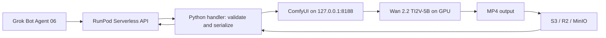

# AutoStudio Video Worker

RunPod Serverless GPU Worker for local Wan 2.2 TI2V-5B inference through ComfyUI. It accepts T2V or I2V jobs, saves MP4 with ComfyUI's built-in `CreateVideo` and `SaveVideo` nodes, uploads the result to S3-compatible storage, and returns a one-hour presigned URL. No third-party video generation API is used.

## Architecture



`handler.py` is the RunPod SDK entry point. `app/` contains validation, GPU/ComfyUI management, workflow binding, and object storage. The two `workflows/wan22_*.json` files are importable ComfyUI UI graphs; matching `*.api.json` files are the API graphs used by the worker. Run `python scripts/build_workflows.py` after changing the graph definition.

## Model and 24GB profile

The model is [Wan 2.2 TI2V-5B](https://github.com/Wan-Video/Wan2.2), which supports both text and image conditioning. The [official ComfyUI 5B template](https://github.com/Comfy-Org/workflow_templates/blob/main/templates/video_wan2_2_5B_ti2v.json) supplies the verified node family and model filenames. [ComfyUI's guide](https://docs.comfy.org/tutorials/video/wan/wan2_2) describes the native workflow. This project uses `UNETLoader`, `CLIPLoader`, `VAELoader`, `ModelSamplingSD3`, `Wan22ImageToVideoLatent`, `KSampler`, `VAEDecode`, `CreateVideo`, `SaveVideo`, and, for I2V, `LoadImage`. `Wan22ImageToVideoLatent.start_image` is optional, so T2V omits it.

The supported first-version profile is 24 FPS, 1–5 integer seconds, and 4n+1 frames (25–121). Resolution choices are `720p` = 1280×704 (the official TI2V 720P size), `720p_portrait` = 704×1280, and an explicit smaller `480p` = 832×480 option. The smaller option is an operational fallback, not a guarantee against OOM. Unsupported values fail before GPU work. `--lowvram` and a 1GB VRAM reserve let ComfyUI offload model parts to system RAM. Use a GPU with at least 22,000 MiB reported VRAM, at least 64GB system RAM, and a fast Network Volume. RTX 3090 24GB is the target. Real speed and 720P memory headroom need testing on that GPU.

These files belong in the Network Volume, **never in Git or the image**:

| Directory under `/runpod-volume/models` | File |
|---|---|
| `diffusion_models` | `wan2.2_ti2v_5B_fp16.safetensors` |
| `text_encoders` | `umt5_xxl_fp8_e4m3fn_scaled.safetensors` |
| `vae` | `wan2.2_vae.safetensors` |

The diffusion and VAE files come from [Comfy-Org/Wan_2.2_ComfyUI_Repackaged](https://huggingface.co/Comfy-Org/Wan_2.2_ComfyUI_Repackaged); the text encoder comes from [Comfy-Org/Wan_2.1_ComfyUI_repackaged](https://huggingface.co/Comfy-Org/Wan_2.1_ComfyUI_repackaged). `extra_model_paths.yaml` makes ComfyUI scan the volume. Start-up checks all three files and the installed core node classes before accepting jobs.

## Deploy on RunPod Serverless

1. Create a RunPod Network Volume in the same region as the endpoint. Mount it at `/runpod-volume`. In a temporary GPU pod with the volume mounted, copy this repository and run `MODEL_ROOT=/runpod-volume/models bash scripts/download_models.sh`. The script uses `hf download`; set `HF_TOKEN` as a secret if access requires it. Allow roughly 20GB for weights plus cache and output space. Confirm the three files at the paths above.
2. Build and publish the container from this repository, for example:

   ```bash
   docker build -t YOUR_REGISTRY/autostudio-video-worker:latest .
   docker push YOUR_REGISTRY/autostudio-video-worker:latest
   ```

   If Docker Hub is unreachable or a configured registry mirror returns invalid
   metadata, override only this build's base-image source. This verified mirror
   resolves to the official PyTorch 2.6.0 image digest for Linux AMD64:

   ```bash
   docker build \
     --build-arg BASE_IMAGE=docker.m.daocloud.io/pytorch/pytorch@sha256:77f17f843507062875ce8be2a6f76aa6aa3df7f9ef1e31d9d7432f4b0f563dee \
     -t YOUR_REGISTRY/autostudio-video-worker:latest .
   ```

   `BASE_IMAGE` defaults to Docker Hub for normal builds. The digest pins the
   image contents when using the mirror.

   If Docker Desktop points at a stopped local proxy (for example
   `127.0.0.1:7897`), clear the proxy build arguments for this command:

   ```bash
   docker build \
     --build-arg BASE_IMAGE=docker.m.daocloud.io/pytorch/pytorch@sha256:77f17f843507062875ce8be2a6f76aa6aa3df7f9ef1e31d9d7432f4b0f563dee \
     --build-arg HTTP_PROXY= --build-arg HTTPS_PROXY= \
     --build-arg http_proxy= --build-arg https_proxy= \
     -t YOUR_REGISTRY/autostudio-video-worker:latest .
   ```

3. Create a RunPod Serverless endpoint using that image, an RTX 3090 24GB or larger GPU, and the same Network Volume. Set the container disk large enough for ComfyUI and temporary MP4s. Set **max concurrent requests per worker to 1** and a job timeout above `JOB_TIMEOUT_SECONDS` (default 1800). Choose worker count and idle timeout based on acceptable cold starts.
4. Add environment secrets: `S3_BUCKET`, `AWS_ACCESS_KEY_ID`, `AWS_SECRET_ACCESS_KEY`, and if needed `S3_ENDPOINT_URL` and `S3_REGION`. R2 uses its account endpoint and `S3_REGION=auto`; AWS S3 uses the AWS region and no custom endpoint; MinIO uses its HTTPS endpoint. The endpoint needs `PutObject`, `GetObject`, and `HeadObject` permissions. Optional `GPU_HOURLY_USD` gives an estimated compute charge.
5. The container starts `handler.py`, verifies `nvidia-smi`, models, storage and ComfyUI API, and then calls `runpod.serverless.start`. ComfyUI binds only to loopback. No public ComfyUI port is required. Check worker logs for initialization errors before sending jobs.

The image currently clones ComfyUI `master` at build time. For reproducible production builds, set `COMFYUI_REF` to a tested release tag when building. Keep models on the Network Volume to avoid downloading on every cold start. Keeping one warm worker reduces model initialization time but increases idle GPU cost. Do not set multiple concurrent requests on one GPU.

## RunPod API

Set `RUNPOD_ENDPOINT_ID` and `RUNPOD_API_KEY` locally. RunPod's `/run` endpoint returns a RunPod job ID; poll `/status/{id}` until `status=COMPLETED`, then read the worker result in `output`. Use `/runsync` only when your client and endpoint timeouts can cover inference.

Text-to-video:

```bash
curl -X POST "https://api.runpod.ai/v2/$RUNPOD_ENDPOINT_ID/run" \
  -H "Authorization: Bearer $RUNPOD_API_KEY" -H 'Content-Type: application/json' \
  -d '{"input":{"task_type":"video_generation","mode":"t2v","prompt":"A futuristic AI laboratory","negative_prompt":"blur, text","duration":5,"resolution":"720p","fps":24,"seed":12345}}'
```

Image-to-video (public HTTPS image):

```bash
curl -X POST "https://api.runpod.ai/v2/$RUNPOD_ENDPOINT_ID/run" \
  -H "Authorization: Bearer $RUNPOD_API_KEY" -H 'Content-Type: application/json' \
  -d '{"input":{"task_type":"video_generation","mode":"i2v","image_url":"https://example.com/image.png","prompt":"The camera glides through a futuristic AI laboratory","negative_prompt":"blur","duration":5,"resolution":"720p","fps":24,"seed":12345}}'
```

Alternatively, pass `image_file` as a base64 image string or `data:image/png;base64,...`. Local filesystem paths cannot be sent through the RunPod HTTP API. Downloaded images are limited to 20 MiB; private-network hosts and redirects are rejected.

Poll:

```bash
curl -H "Authorization: Bearer $RUNPOD_API_KEY" \
  "https://api.runpod.ai/v2/$RUNPOD_ENDPOINT_ID/status/JOB_ID"
```

The worker `output` on success resembles:

```json
{"status":"completed","task_id":"JOB_ID","video_url":"https://storage.example.com/presigned-mp4","duration":5,"resolution":"720p","generation_time":342.17,"estimated_gpu_cost_usd":0.095047}
```

`generation_time` measures wall-clock time from the start of handler execution through upload. `estimated_gpu_cost_usd` is `generation_time / 3600 × GPU_HOURLY_USD`, not a RunPod bill. A retry with the same RunPod job ID checks S3 first and returns the existing video with `cached=true`; a presigned URL expires after one hour and can be refreshed by retrying that ID. Configure the RunPod job retention and your S3 lifecycle policy separately.

## Local verification and troubleshooting

With Python and pytest installed, run `python scripts/build_workflows.py` and `python -m pytest -q`. Import `workflows/wan22_t2v.json` or `workflows/wan22_i2v.json` into a recent ComfyUI to inspect the UI graphs. For a real worker test, attach a 24GB GPU and the model volume, set S3 credentials, run `python scripts/test_gpu.py`, then `python handler.py`. A full I2V test requires a reachable public HTTPS image or base64 `image_file`.

| Symptom | Check |
|---|---|
| Missing model file | Verify mount path and exact names from the table. Run `scripts/download_models.sh` on the mounted volume. |
| Missing ComfyUI node | Update ComfyUI to a version containing the official 5B template nodes; check `/object_info` in worker logs. |
| Out of memory | Retry `resolution=480p` or shorter `duration`; keep concurrency at one and allow CPU offloading. |
| ComfyUI timeout | Increase both `JOB_TIMEOUT_SECONDS` and RunPod endpoint timeout; inspect logs for stalled download or OOM. |
| Image download failure | Use public HTTPS, allow DNS egress, and keep input below 20 MiB. |
| Upload failure | Check bucket permissions, endpoint, credentials, and object storage reachability. A job is not marked complete until upload succeeds. |
| Cold start is slow | Keep models on the Network Volume; use a warm worker if latency matters. |

### Verification status

Static workflow checks and local unit tests were run. A full Docker build succeeded using the pinned mirror digest and cleared proxy build arguments shown above; a CPU-only import check inside the image passed. The development host reports a 6GB GPU, so Wan 2.2 inference, 720P MP4 generation, 24GB OOM behavior, and S3 upload on RunPod have not been tested here. Treat T2V and I2V GPU smoke tests plus an S3 upload as required deployment gates.
